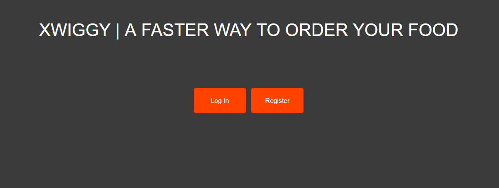
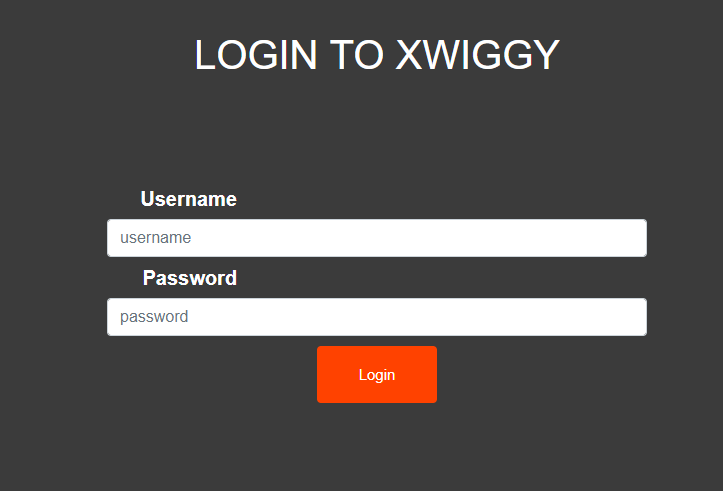
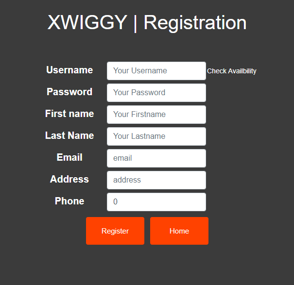
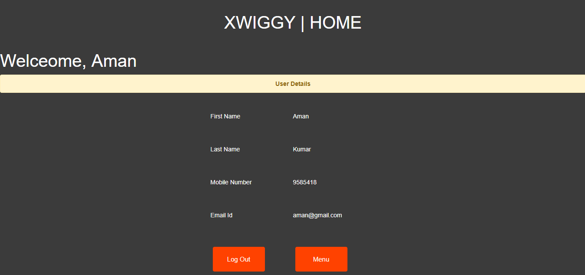
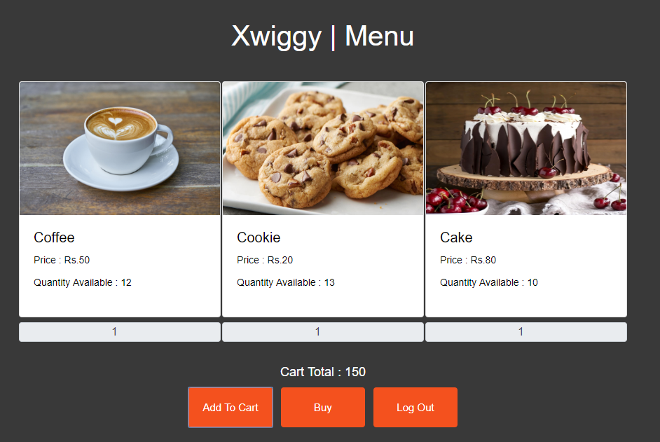
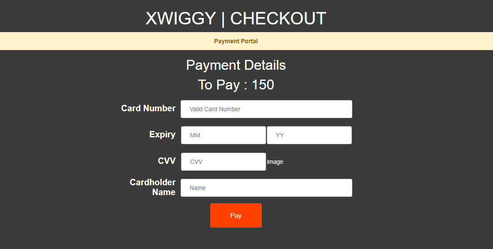
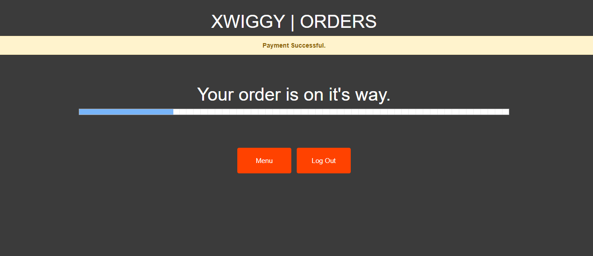
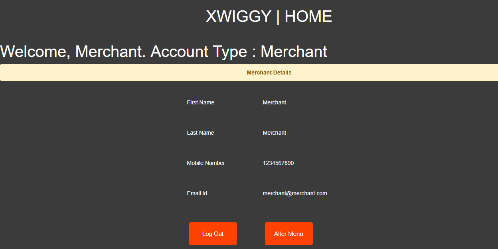
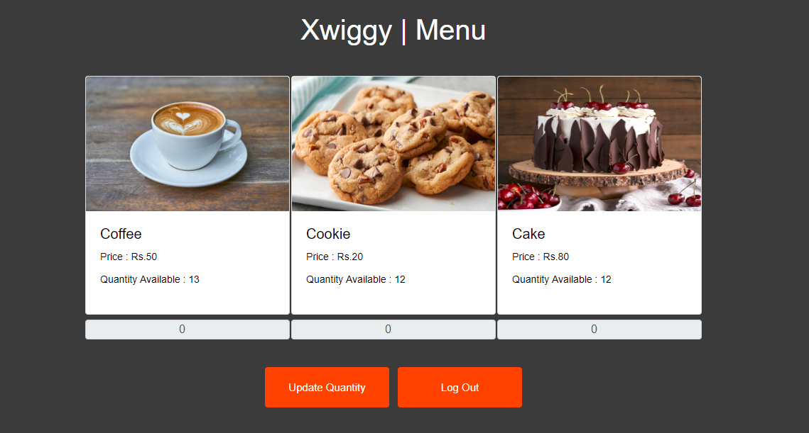

# Xwiggy
Sistema de Pedidos de Comida

# Sobre el Proyecto
Xwiggy es un sistema normal de pedidos de comida que implementa la arquitectura MVC (Modelo-Vista-Controlador). <br>
Como Vista, se utiliza Angular-8 con enrutamiento. Para el backend, se utiliza Spring Boot v2.1.6. Para el soporte de Base de Datos, se ha utilizado MySql.
Se utiliza Java Persistence Api (JPA) para escribir la lógica de negocio. Se han escrito REST Api's para comunicarse entre los puertos del servidor 
(Angular-> puerto:4200, SpringBoot -> puerto:8080, MySql -> puerto:3306)

El proyecto consiste en una página de Inicio de Sesión y Registro cuando el usuario navega a localhost:4200. Tras un inicio de sesión o Registro exitoso como usuario, aparece una página de bienvenida con todos los detalles del usuario y la opción de pedir comida. La página de Menú enumera todos los artículos disponibles en la base de datos con su cantidad disponible.
Cuando se añaden artículos al carrito y se navega a la página de pago, se solicitan los datos de la tarjeta. Al hacer clic en la opción de pagar ahora, la cantidad comprada se descuenta tanto de la DB como del componente de Menú.

De manera similar, cuando una persona inicia sesión o se registra como comerciante (merchant), aparece una página con los detalles del comerciante y una opción para alterar el menú. Si un comerciante añade cantidad, se realiza una solicitud POST y la DB se actualiza automáticamente. El componente se refresca solo y la página no necesita recargarse para ver los cambios.

# Pre-Requisitos
1. [Java 7 o Superior](https://java.com/en/download/help/download_options.xml) instalado en el dispositivo
2. Servidor MySQL
3. NodeJS - npm

## Instalación
Clona el repositorio de [git](https://github.com/3point141/Xwiggy-Angular8-SpringBoot-MVC-JPA-MYSQL) para usar Xwiggy.

```
git clone https://github.com/3point141/Xwiggy-Angular8-SpringBoot-MVC-JPA-MYSQL.git
```
| proyecto | Funcionalidad |
|----|-------|
| xwiggy-app| Frontend |
| xwiggy-back | Backend |

## Ejecutar en Máquina Host

1. Abre xwiggy-app como un proyecto
```
ng build
ng serve
```
Esto iniciará tu servidor de frontend en http://localhost:4200
<br>
2. Abre xwiggy-back como un proyecto
```
Start MySql Server
Run src/main/resources/dbScripts/ddl.sql
```
Esto creará la base de datos "myusers" en tu Servidor MySql ejecutándose en http://localhost:3306
Si has configurado la dirección del servidor MySql en algún otro puerto, puedes cambiar esa url en el archivo Application.properties.<br>
Ubicación : src/main/resources/application.properties

```
Run src/main/java/com/xwiggy/food/XwiggyApplication.java
```
Esto pondrá en marcha Spring Boot en http://localhost:8080

## Ejecutar usando Vagrant Box
Encuentra el archivo Vagrant en [Vagrant Resources](https://github.com/3point141/Xwiggy-Angular8-SpringBoot-MVC-JPA-MYSQL/tree/master/Vagrant%20Resources) <br>
La carpeta también contiene un script de shell que ayudará a instalar las dependencias en la máquina virtual al momento del arranque.<br>

1. Descarga [Oracle Virtual Box](https://www.virtualbox.org/wiki/Downloads) e instálalo en tu máquina host. <br><br>
2. Descarga [Vagrant Box](https://www.vagrantup.com/downloads.html) de HashiCorp e instálalo en tu máquina host <br>
Navega a la ubicación del archivo vagrant y abre tu Terminal/Cmd
```
vagrant up
```
Esto creará tu máquina virtual en oracle virtual box o cualquier proveedor de servicio para vm con las especificaciones:

Especificación | Descripción 
 --- | --- 
 Sistema Operativo | ubuntu/trusty64(x64) v20190429.0.1 
 Memoria Base | 512 MB 

Estos servicios se instalarán automáticamente mediante el script de shell :white_check_mark:

~~~
* npm - 6.4.1 
* node - v10.14.0 
* MySql server
~~~
***La contraseña para MySQL será abcd1234***

3. Toma el archivo jar de [aquí](https://github.com/3point141/Xwiggy-Angular8-SpringBoot-MVC-JPA-MYSQL/tree/master/FinalBuild) y colócalo en la ubicación del archivo vagrant. <br>

4. Importando el script de mySql desde [aquí](https://github.com/3point141/Xwiggy-Angular8-SpringBoot-MVC-JPA-MYSQL/tree/master/Vagrant%20Resources) hacia la Vagrant box. SSH en la Vagrant box vía terminal/cmd en la ubicación del archivo vagrant
```
vagrant ssh
sudo mysql -u root -p
create database myusers
exit
```

5. Instalando JDK. En la misma terminal donde se realizó el ssh a la Vagrant Box, ejecuta el siguiente comando
```
sudo add-apt-repository ppa:openjdk-r/ppa -y
sudo apt-get update
sudo apt-get -y install openjdk-8-jdk
```
Esto instalará Java para ejecutar el archivo JAR. <br>
<br>

6. Editando el archivo Host.<br>
Para usuarios de Windows
```
c:\Windows\System32\Drivers\etc\hosts
```
Edita el archivo como Administrador. Añade esta línea al final
```
192.168.33.10 vgdemo.local www.xwiggy.com 
```
***vgdemo es el nombre de la carpeta donde se encuentra el archivo y la box de vagrant***

7. Ejecutando el archivo JAR dentro de Vagrant Box
```
cd /var/www/html/
java -jar xwiggy-0.0.1-SNAPSHOT.jar
```
8. abre el navegador y navega a http://xwiggy.com:8080 <br />
9. Disfruta :relieved:

## Rest Api's
| Mapeo de Url | Tipo | Función |
|----|---|---|
| /login | POST | Recibe objetos Modelo de Login, Valida, Devuelve objeto modelo de Usuario |
| /login | GET | Devuelve un nuevo objeto modelo de Login |
| /register | POST | Acepta objeto modelo de Usuario para registro, Devuelve objeto modelo de Usuario|
| /register | GET | Devuelve un nuevo objeto modelo de Usuario |
| /checkUserName | Post | Acepta String username, Devuelve Booleano si existe o no |
| /menu | GET | Devuelve Lista de objetos modelo de Comida |
| /cart | POST | Acepta objeto modelo de Carrito, Devuelve Entero del total de todos los productos comprados |
| /changeDB | GET | Devuelve Booleano si la DB se actualiza después de realizar una compra |

## Capturas de Pantalla del Funcionamiento
<table>
  <tr>
    <td></td>
    <td></td>
  </tr>
  <tr>
    <td></td>
    <td></td>
  </tr>
  <tr>
    <td></td>
    <td></td>
  </tr>
  <tr>
    <td></td>
    <td></td>
  </tr>
 </table>
 <div class="center">
    
 </div>

## Autor 
Hecho con :heart: por Aman Kumar - [3point141](https://github.com/3point141)

:zap: Este proyecto está en una etapa muy temprana. Se pueden notar algunos errores con frecuencia. Siéntete libre de probarlo y reportar los bugs.
